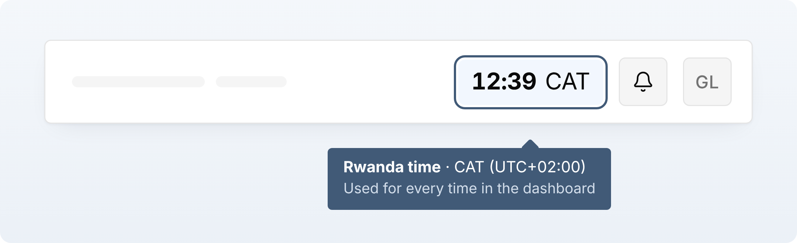

You can reach customers, members, students and whole communities in two ways:

- **The dashboard**: upload a contact list or type numbers, then send now or schedule for later. No code needed.
- **The REST API**: send messages straight from your own backend, for alerts, one-time passwords (OTPs) and notifications.

## How Gliiv works

<Steps>
  <Step title="Create an account">
    Sign up with email, Google or GitHub.
  </Step>
  <Step title="Get an approved Sender">
    A Sender is the name recipients see on your messages. The Gliiv team assigns Senders to your account for compliance.
  </Step>
  <Step title="Have credits on your Sender">
    Each Sender has its own credit balance. One SMS to one recipient costs 1 credit.
  </Step>
  <Step title="Send">
    Use the dashboard for campaigns, or the API for automated messages.
  </Step>
</Steps>

## Ways to send

|  | Dashboard | API |
| :-- | :-- | :-- |
| **Send now** | ✅ | ✅ |
| **Schedule for later** | ✅ (at least 3 hours ahead) | ❌ |
| **Recipients per send** | Upload a CSV or Excel file (up to 20 MB) or type numbers | Up to 20 numbers per request |
| **Personalization** (`{{name}}`) | ✅ (file upload only) | ❌ |
| **Best for** | Marketing, announcements, reminders | OTPs, alerts, transaction notifications |

<Note>
  The API sends messages immediately. To schedule messages, create a campaign in the dashboard.
</Note>

## Coverage

Gliiv sends to **Rwandan mobile numbers only**. Numbers can be written in any of these formats:

`+2507XXXXXXXX` · `2507XXXXXXXX` · `07XXXXXXXX` · `7XXXXXXXX`

Numbers outside Rwanda aren't supported yet.

## Time zone

<Info>
  **Every time in the Gliiv dashboard is in Rwanda time: Central Africa Time (CAT, UTC+02:00).** Rwanda doesn't use daylight saving time, so the offset never changes.
</Info>

The current Rwanda time is always shown in the dashboard header, next to the notifications bell:

<Frame caption="The dashboard header shows the current Rwanda time.">
  
</Frame>

This applies everywhere in the dashboard: campaign schedules, creation dates, API key expiry dates and delivery reports.

**The API is different:** it returns timestamps in UTC, in strict ISO 8601 format with a `Z` suffix. For example, `2026-11-15T10:39:00.000Z` in the API is **12:39 CAT** in the dashboard.

## Next steps

<CardGroup cols={2}>
  <Card title="Quickstart" icon="rocket" href="/quickstart">
    Set up your account and send your first SMS.
  </Card>

  <Card title="Create a campaign" icon="megaphone" href="/create-campaign">
    Send or schedule bulk SMS from the dashboard. No code needed.
  </Card>

  <Card title="Authentication" icon="key" href="/authentication">
    Create an API key and authenticate your requests.
  </Card>

  <Card title="Send SMS" icon="send" href="/send-sms">
    The API endpoint for sending messages.
  </Card>
</CardGroup>

## Need help?

- **Email:** [hello@gliiv.com](mailto:hello@gliiv.com)
- **Phone:** +250 788 450 080

{/*  - **Phone:** +250 788 450 080, or toll-free **6035** (from within Rwanda)  */}

- **System status:** [status.gliiv.com](https://status.gliiv.com/)
