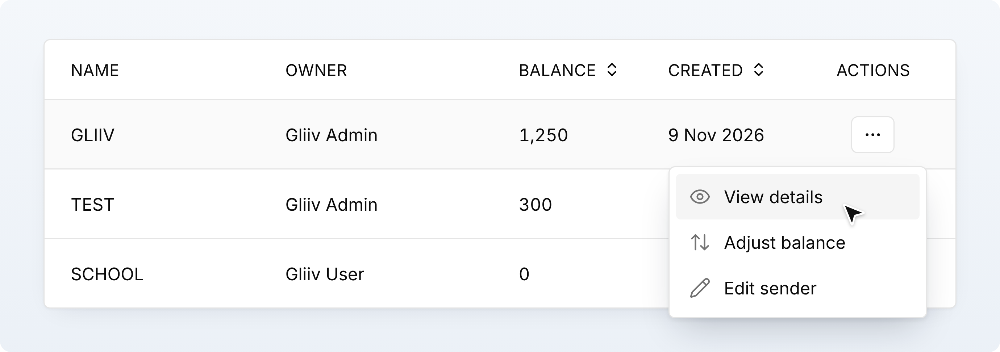

Before you can send messages you need three things: a Gliiv account, an approved Sender, and credits on that Sender.

## 1. Create your account

[Sign up](https://www.gliiv.com/app/auth/signup) with your email, Google or GitHub account. If you already have one, sign in to open your dashboard.

## 2. Get an approved Sender

A **Sender** is the name recipients see as the message source, for example `GLIIV`. For compliance, the Gliiv team assigns Senders to accounts manually, so you can't create one yourself.

**Check whether you already have one:** open the **Senders** tab in your dashboard. Any Sender listed there is ready to use.

**If the list is empty, request a Sender** using any of these:

- **Email:** [hello@gliiv.com](mailto:hello@gliiv.com)
- **Phone:** +250 788 450 080
- The contact form on [gliiv.com](https://www.gliiv.com/)

{/*  - **Phone:** +250 788 450 080, or toll-free **6035** (from within Rwanda)  */}

<Note>
  There's no fixed approval time. The team assigns Senders as quickly as it can, and the Sender appears in your Senders tab once it's approved.
</Note>

## 3. Check your credits

Each Sender has its own **credit balance**, shown in the Senders tab. One SMS to one recipient costs **1 credit**. Longer messages are split into several SMS and cost 1 credit per part. See [message length and credits](/create-campaign#credits-and-message-length).

## 4. Send your first message

Choose how you want to send:

<Tabs>
  <Tab title="Dashboard (no code)">
    <Steps>
      <Step title="Start a campaign">
        Go to **Campaigns** and click **Create Campaign**.
      </Step>
      <Step title="Pick a Sender">
        Choose one of your approved Senders from the dropdown.
      </Step>
      <Step title="Write your message">
        Type your message. A live counter shows how many characters you've used and how many SMS it will be split into.
      </Step>
      <Step title="Add recipients">
        Paste phone numbers one per line, or upload a CSV or Excel file.
      </Step>
      <Step title="Send or schedule">
        Click **Submit** to send now, or turn on **Schedule Message?** to send at least 3 hours later.
      </Step>
    </Steps>

    <Info>
      Scheduled times are in **Rwanda time (CAT, UTC+02:00)**, like every time in the dashboard.
    </Info>

    For file formats, personalization and campaign statuses, see the full guide: [Create a campaign](/create-campaign).
  </Tab>
  <Tab title="API (automated)">
    Use the API to send messages immediately from your own backend, for things like OTPs, alerts and notifications.

    <Steps>
      <Step title="Create an API key">
        Go to **Settings → API Keys** ([open it](https://www.gliiv.com/app/settings/api-key)) and click **Create Key**.

        - **Name** (required): a label so you can tell your keys apart, for example `Production server`.
        - **Expiry date** (optional): leave it empty for a key that never expires.

        <Warning>
          Copy the key as soon as it's created. It's shown only once, and if you leave or refresh the page you can't see it again.
        </Warning>
      </Step>
      <Step title="Copy your Sender ID">
        The API identifies a Sender by its **ID**, not its display name.

        1. Open the **Senders** tab.
        2. In the **Actions** column of the Sender you want, click the **⋯** button.
        3. Choose **View details**.
        4. Copy the **ID**.

        <Frame caption="Open the Actions menu and choose View details.">
          
        </Frame>

        You can also get Sender IDs from the API with [List senders](/list-senders).
      </Step>
      <Step title="Send the message">
        Make a `POST` request to `/messages/send`:

        <CodeGroup>

        ```bash cURL
        curl -X POST https://api.gliiv.com/v1/api/messages/send \
          -H "x-api-key: $GLIIV_API_KEY" \
          -H "Content-Type: application/json" \
          -d '{
            "phoneNumbers": ["+2507XXXXXXXX", "07XXXXXXXX"],
            "message": "Hello from Gliiv!",
            "senderId": "6650f1c2a9e4b7d3c1a2b3c4"
          }'
        ```

        ```javascript Node.js
        const response = await fetch("https://api.gliiv.com/v1/api/messages/send", {
          method: "POST",
          headers: {
            "x-api-key": process.env.GLIIV_API_KEY,
            "Content-Type": "application/json",
          },
          body: JSON.stringify({
            phoneNumbers: ["+2507XXXXXXXX", "07XXXXXXXX"],
            message: "Hello from Gliiv!",
            senderId: "6650f1c2a9e4b7d3c1a2b3c4",
          }),
        });
        
        console.log(response.status, await response.json());
        ```

        ```python Python
        import os
        import requests
        
        response = requests.post(
            "https://api.gliiv.com/v1/api/messages/send",
            headers={"x-api-key": os.environ["GLIIV_API_KEY"]},
            json={
                "phoneNumbers": ["+2507XXXXXXXX", "07XXXXXXXX"],
                "message": "Hello from Gliiv!",
                "senderId": "6650f1c2a9e4b7d3c1a2b3c4",
            },
        )
        
        print(response.status_code, response.json())
        ```

        </CodeGroup>

        Replace the phone numbers with real recipients and `senderId` with the ID you copied. Keep your API key in an environment variable (`GLIIV_API_KEY`), never in your code.
      </Step>
    </Steps>

    ### Successful response

    A `200` response means Gliiv has accepted the messages and queued them for sending:

    ```json
    {
      "message": "Messages are being sent",
      "status": 200
    }
    ```

    ### Common errors

    | Status | Meaning | What to do |
    | :-- | :-- | :-- |
    | `400` | A field is missing or invalid | Check `validationErrors` in the response for the field that failed. |
    | `401` | The API key is missing or invalid | Check the `x-api-key` header. Make sure the key hasn't expired, been rotated or been deleted. |
    | `404` | No Sender found with that ID | Copy the ID again from **⋯ → View details**. |
    | `429` | Too many requests | Wait the number of seconds in the `Retry-After` header, then try again. |

    See [Errors](/errors) for the full list.

    ### Limits

    - **Up to 20 phone numbers per request.** To reach more people, split the list across several requests, or use a [dashboard campaign](/create-campaign) with a file upload.
    - **Up to 800 characters per message.**
    - **Up to 60 requests per minute per API key.** See [Rate limits](/rate-limits).
    - **No scheduling.** The API sends immediately. To schedule, use the dashboard.
    - **Rwandan numbers only**, in any of these formats: `+2507XXXXXXXX`, `2507XXXXXXXX`, `07XXXXXXXX` or `7XXXXXXXX`.
  </Tab>
</Tabs>

## Next steps

<CardGroup cols={2}>
  <Card title="Create a campaign" icon="megaphone" href="/create-campaign">
    Personalize messages, upload files and schedule sends.
  </Card>

  <Card title="Authentication" icon="key" href="/authentication">
    Manage, rotate and secure your API keys.
  </Card>

  <Card title="Send SMS" icon="send" href="/send-sms">
    Full reference for the send endpoint.
  </Card>

  <Card title="List senders" icon="list" href="/list-senders">
    Get your Sender IDs and balances from the API.
  </Card>
</CardGroup>
